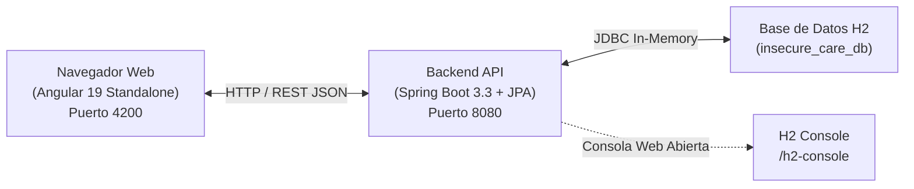

# 🏥 InsecureCare - Portal Clínico Confidencial (Entorno de Auditoría OWASP)

> **UNIVERSIDAD DE COSTA RICA**  
> **SEDE DEL ATLÁNTICO - RECINTO PARAÍSO**  
> **CARRERA DE INFORMÁTICA EMPRESARIAL**  
> **CURSO:** IF0009 - Desarrollo de Software IV  
> **TEMA:** 06 - Seguridad Web y Móvil  
> **EVALUACIÓN ASOCIADA:** Quiz 9 (Auditoría Forense de Vulnerabilidades Web)  

---

## ⚠️ Descargo de Responsabilidad Ético y Pedagógico

> [!CAUTION]
> **ENTORNO INTENCIONALMENTE VULNERABLE:**  
> Esta aplicación web fue desarrollada **exclusivamente con fines académicos y pedagógicos** para el curso IF0009. Contiene deliberadamente debilidades de seguridad del estándar **OWASP Top 10**. **Bajo ninguna circunstancia copie, traslade o reutilice estos patrones de código en proyectos reales o entornos de producción.**

---

## 🏛️ Arquitectura del Sistema



* **Frontend:** Single-Page Application en **Angular 19** con Standalone Components y Angular Signals.
* **Backend:** API REST en **Java 21/25** con **Spring Boot 3.3+**, Spring Data JPA y soporte para JWT.
* **Base de Datos:** Motor relacional **H2 Database** en memoria volátil con aprovisionamiento automático mediante scripts ANSI SQL (`schema.sql` y `data.sql`), lo que elimina la necesidad de configurar servidores de bases de datos externos.

---

## 📋 Requisitos Previos de Software

Antes de iniciar, verifique que su entorno de desarrollo cuente con las siguientes herramientas ejecutando los siguientes comandos en su terminal:

```bash
# 1. Verificar versión de Git
git --version

# 2. Verificar versión de Java (Requiere Java 21 LTS o Java 25)
java -version

# 3. Verificar versión de Node.js y npm (Requiere Node.js v20 LTS o superior)
node -v
npm -v

# 4. Verificar versión de Maven (Opcional, el proyecto incluye Maven Wrapper)
mvn -version
```

---

## 📥 Paso 0: Clonado y Ubicación del Proyecto

Si está clonando el repositorio completo de la cátedra desde GitHub / GitLab, abra su terminal y ejecute:

```bash
# Clonar el repositorio del curso
git clone https://github.com/jonnexusinsights-lab/unsecure_web_app.git

# Navegar a la carpeta específica de la aplicación web vulnerable
cd /web_apps/unsecure_web_app
```

> [!NOTE]
> La estructura del proyecto se organiza de la siguiente manera:
> ```
> unsecure_web_app/
> ├── backend/                         # Proyecto Spring Boot (Maven)
> │   ├── mvnw / mvnw.cmd              # Maven Wrapper integrado
> │   ├── pom.xml                      # Dependencias del backend
> │   └── src/main/resources/          # schema.sql, data.sql, application.properties
> ├── frontend/                        # Proyecto Angular 19 Standalone
> │   ├── package.json                 # Dependencias Node.js
> │   └── src/                         # Código fuente Angular
> ├── unsecure_web_app.code-workspace  # Espacio de trabajo multiraíz para VS Code
> └── README.md                        # Esta guía de ejecución
> ```

---

## 🚀 Método 1: Puesta en Marcha con VS Code (Recomendado - 1 Clic)

El proyecto incluye un espacio de trabajo multiraíz (**Multi-root Workspace**) preconfigurado con tareas de ejecución automática para Visual Studio Code.

### Pasos:

1. **Abrir el Workspace:**
   * Abra Visual Studio Code.
   * Vaya al menú principal: **Archivo (File) > Abrir espacio de trabajo desde archivo... (Open Workspace from File...)**.
   * Seleccione el archivo: `unsecure_web_app.code-workspace`.
   * Verá ambas carpetas (`Backend` y `Frontend`) montadas en el panel explorador.

2. **Ejecutar Tareas Integradas:**
   * Presione la combinación de teclas: `Ctrl + Shift + B` (o abra la paleta de comandos con `Ctrl + Shift + P` y escriba `Tasks: Run Build Task`).
   * Seleccione y ejecute en orden:
     1. **Instalar Dependencias Frontend (npm install)** *(solo necesario la primera vez)*.
     2. **Iniciar Backend (Spring Boot)**.
     3. **Iniciar Frontend (Angular)**.

3. **Acceder a la Aplicación:**
   * Abra su navegador web en: **`http://localhost:4200`**.

---

## 💻 Método 2: Puesta en Marcha Manual desde Terminal (Multiplataforma)

Si prefiere utilizar la terminal o no utiliza Visual Studio Code, siga estos pasos abriendo **dos ventanas de consola independientes**:

### Terminal 1: Backend (Spring Boot 3 + H2)

Navegue a la carpeta `backend` y ejecute el servidor:

#### En Windows (PowerShell / CMD):
```powershell
cd backend

# Opción A (Recomendada con Maven Wrapper integrado - no requiere Maven global):
.\mvnw.cmd spring-boot:run

# Opción B (Si tiene Maven instalado globalmente):
mvn spring-boot:run
```

#### En macOS / Linux:
```bash
cd backend

# Asegurar permisos de ejecución en el wrapper
chmod +x mvnw

# Ejecutar Spring Boot
./mvnw spring-boot:run
```

> **Verificación del Backend:**  
> Cuando el servidor termine de inicializar, observará en la terminal el mensaje:  
> `Started InsecureCareApplication in X.XXX seconds (process running for X.XXX)`.  
> * **API REST activa:** `http://localhost:8080/api/expedientes`  
> * **Consola H2 Database:** `http://localhost:8080/h2-console`

---

### Terminal 2: Frontend (Angular 19 Standalone)

Abra una **segunda ventana de terminal**, navegue a la carpeta `frontend` y levante el servidor cliente:

```bash
cd frontend

# Paso 1: Instalar dependencias de Node.js (solo la primera vez)
npm install

# Paso 2: Iniciar servidor de desarrollo en el puerto 4200
npm start
```

> **Verificación del Frontend:**  
> Una vez finalizada la compilación, verá en consola:  
> `Application bundle generation complete.`  
> `Local: http://localhost:4200/`

---

## 🌐 Verificación de Salud de los Servicios

Una vez iniciados ambos servicios, verifique el acceso a los siguientes puntos de entrada:

| Servicio | URL de Acceso | Descripción / Credenciales |
| :--- | :--- | :--- |
| **Portal Web (Frontend)** | `http://localhost:4200` | Interfaz gráfica del sistema clínico con accesos de prueba. |
| **API REST (Backend)** | `http://localhost:8080/api/expedientes` | Endpoint público que expone los expedientes médicos en formato JSON. |
| **Consola H2 Database** | `http://localhost:8080/h2-console` | Gestor de base de datos web. <br/>• **JDBC URL:** `jdbc:h2:mem:insecure_care_db`<br/>• **User Name:** `sa`<br/>• **Password:** *(dejar vacío)* |

---

## 👥 Cuentas de Usuario Preconfiguradas para Pruebas

La base de datos se carga automáticamente con cinco usuarios de prueba para evaluar los controles de autenticación y autorización:

| Nombre de Usuario | Contraseña | Rol en Sistema | ID de Usuario | Expediente Asignado | Propósito en la Auditoría |
| :--- | :--- | :--- | :---: | :---: | :--- |
| `carlos_mora` | `carlos123` | `PACIENTE` | `3` | Expediente #1 (`EXP-2026-001`) | Usuario base para probar IDOR y escalación horizontal. |
| `maria_rojas` | `maria123` | `PACIENTE` | `4` | Expediente #2 (`EXP-2026-002`) | Paciente con diagnóstico psiquiátrico confidencial (víctima de IDOR). |
| `ana_solis` | `ana2026` | `PACIENTE` | `5` | Expediente #3 (`EXP-2026-003`) | Paciente con diabetes y registro con indicador visual. |
| `dr_vargas` | `doctor2026` | `MEDICO` | `2` | — | Profesional de salud facultado para emitir recetas y diagnósticos. |
| `admin` | `admin123` | `ADMIN` | `1` | — | Administrador general de la infraestructura clínica. |

> [!TIP]
> En la pantalla de inicio de sesión (`/login`), dispone de botones de acceso rápido que autocompletan las credenciales de estos usuarios con un solo clic.

---

## 🔧 Solución de Problemas Frecuentes (Troubleshooting)

### 1. Error de permisos de scripts en Windows PowerShell
* **Síntoma:** `npm : No se puede cargar el archivo ... porque la ejecución de scripts está deshabilitada en este sistema (PSSecurityException)`.
* **Solución:** Ejecute en su consola de PowerShell con permisos normales:
  ```powershell
  Set-ExecutionPolicy -Scope Process -ExecutionPolicy Bypass
  ```
  O alternativamente invoque el comando con la extensión cmd:
  ```powershell
  npm.cmd install
  npm.cmd start
  ```

---

### 2. Error: Puerto 8080 o 4200 ya en uso
* **Síntoma:** `Web server failed to start. Port 8080 was already in use` o `Port 4200 is already in use`.
* **Solución (Windows):** Identifique el proceso que ocupa el puerto y ciérrelo:
  ```powershell
  # Buscar PID del proceso en el puerto 8080
  netstat -ano | findstr :8080

  # Terminar el proceso por PID (reemplace <PID> por el número obtenido)
  taskkill /PID <PID> /F
  ```
  *En macOS / Linux:*
  ```bash
  lsof -ti :8080 | xargs kill -9
  lsof -ti :4200 | xargs kill -9
  ```

---

### 3. Incompatibilidad de versión de Java al compilar el Backend
* **Síntoma:** `Fatal error compiling: error: release version not supported`.
* **Solución:** Verifique qué versión de Java está utilizando Maven ejecutando `mvn -version` o `.\mvnw.cmd -version`. Si apunta a una versión inferior a Java 21, configure temporalmente su variable `JAVA_HOME`:
  ```powershell
  # PowerShell (Windows)
  $env:JAVA_HOME = "C:\Ruta\A\Su\JDK-21-o-25"
  $env:Path = "$env:JAVA_HOME\bin;" + $env:Path
  ```

---

### 4. Conflictos al instalar dependencias de Angular (`npm install`)
* **Síntoma:** Error de resolución de árbol de dependencias (`ERESOLVE unable to resolve dependency tree`).
* **Solución:** Fuerce la instalación con resolución compatible de pares:
  ```bash
  npm install --legacy-peer-deps
  ```

---

## 🎯 Instrucciones para la Auditoría Forense (Quiz 9)

Una vez que la aplicación esté levantada y operativa:

1. **Abra el cuestionario de evaluación:**  
   Consulte el archivo [`Evaluaciones/Quices/Quiz_9/Quiz_9.md`](../../Evaluaciones/Quices/Quiz_9/Quiz_9.md) (o su versión PDF [`Quiz_9.pdf`](../../Evaluaciones/Quices/Quiz_9/Quiz_9.pdf)).
2. **Explore la aplicación web con mentalidad de auditor:**
   * Pruebe la barra de búsqueda clínica ingresando payloads de inyección SQL (ejemplo: `' OR '1'='1`).
   * Inicie sesión como `carlos_mora` e intente acceder al expediente de `maria_rojas` modificando la URL o manipulando peticiones REST.
   * Regístrese o cree un nuevo expediente insertando código HTML/JavaScript (ejemplo: ``) y verifique si se ejecuta en el navegador.
   * Inspeccione la base de datos en `/h2-console` y analice cómo se guardan las contraseñas de los usuarios.
   * Provoque un error en la API y examine el nivel de detalle entregado en la respuesta JSON (*Stack Trace*).
3. **Complete la Hoja de Hallazgos:**  
   Llene la plantilla *Pentest Findings Sheet* incluida en el Quiz 9 con las 5 vulnerabilidades detectadas, sus evidencias y sus propuestas de remediación.
